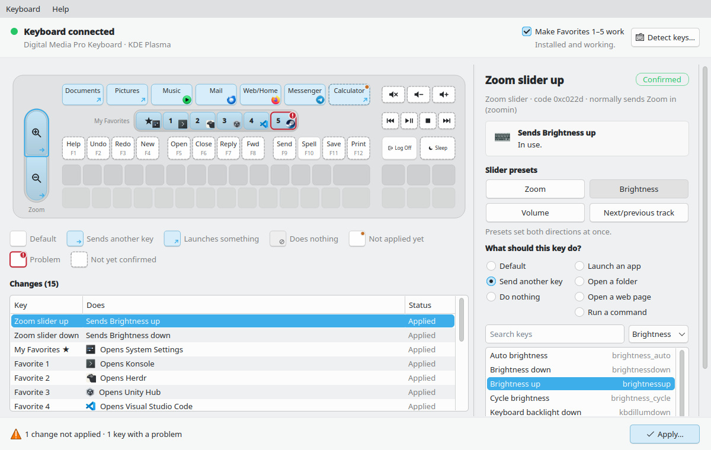

# Digital Media Pro Keys

Make every special key on the **Microsoft Digital Media Pro Keyboard** (USB
`045E:00B0`) do something useful on Linux: the zoom slider, the My Favorites
keys (★ and 1–5), the launch keys (My Documents, My Pictures, My Music, Mail,
Web/Home, Messenger), the media keys and the F Lock functions.



Pick a key, choose what it does, press **Apply**:

- **Send another key**: e.g. the zoom slider as brightness or volume
- **Launch an app**, **open a folder**, **open a URL** or **run a command**
- **Disable** it

Out of the box, several of these keys do nothing on Linux. Keys 1–5 are dropped
by the generic HID driver, and the slider, My Pictures, My Music, Spell and
Log Off send key codes no desktop can bind. The app fixes both; see
[How it works](#how-it-works).

Not affiliated with Microsoft.

## Supported desktops

| Desktop | Remap to other keys | Bind apps/folders/commands |
|---|---|---|
| KDE Plasma 6 | ✓ | ✓ (tested) |
| GNOME | ✓ | ✓ (untested; see [limitations](#limitations)) |
| Others | ✓ | – |

## Install

Packages are attached to each [release](https://github.com/newmca/microsoft-digital-media-pro/releases):

| Format | Works on |
|---|---|
| `.rpm` | Fedora 44 |
| `.deb` | Debian 13, Ubuntu 25.10, 26.04 (Ubuntu 24.04 has no PySide6 packages) |
| `.AppImage` | x86-64 distributions with glibc 2.34+ (needs `pkexec` and `/usr/bin/python3` on the host) |
| `.flatpak` | Any distribution with Flatpak (same host requirements as the AppImage) |

From source: `pip install .` then run `dmpkeys` (needs PySide6 and jeepney).
The root helper is then run through polkit's generic prompt.

## Using it

1. Start **Digital Media Pro Keys**. On first run it offers to import a setup
   you made by hand (hwdb files, KDE shortcuts).
2. Click a key on the keyboard picture and choose what it should do.
3. Press **Apply**. Changing key codes and installing the favorites fix asks
   for your admin password once; desktop shortcuts don't.

**Detect keys** shows which key you pressed, confirms keys whose codes are
standard but not yet measured on this keyboard, and lets you add keys the app
doesn't know.

**Remove all changes made by this app** (in the menu) uninstalls everything it
put on the system and unbinds its shortcuts.

Command line: `dmpkeys status`, `dmpkeys plan`, `dmpkeys apply`, `dmpkeys import`,
`dmpkeys reset`.

## How it works

Three layers, each kept to the minimum:

1. **Favorites fix** (root, once): a udev rule moves the keyboard's media
   interface from `hid-generic` to `hid-microsoft` with the quirk the kernel
   already gives its sibling model `045E:00B4`. That driver decodes keys 1–5.
2. **Key codes** (root): a udev hwdb file (`/etc/udev/hwdb.d/70-dmpkeys.hwdb`)
   remaps scancodes, either to the key you chose, or, for keys with no usable
   code, to a spare key code that the desktop can bind.
3. **Actions** (your session): global shortcuts on the key's code, via KDE's
   kglobalaccel or GNOME's custom keybindings.

Root changes go through a small helper run with `pkexec`
(`src/dmpkeys/helper.py`). It accepts only hwdb content for this keyboard,
installs only its own three files, and only disables (renames) other configs
that target this keyboard.

The details, including the measurements and dead ends behind them, are in
[docs/NOTES.md](docs/NOTES.md).

## Limitations

- Keys marked "not yet confirmed" use the standard HID codes for their
  function; use **Detect keys** to check them on your keyboard.
- GNOME support is untested. An earlier GNOME setup found that bindings on
  `XF86Launch1-4` never fired. The favorites keys arrive as `XF86Launch5-9`,
  so they may not be bindable on GNOME.
- The AppImage and Flatpak run the root helper with the host's `python3`, so
  the authentication prompt names python3 rather than this app.
- The Flatpak is not sandboxed in any meaningful sense: it needs
  `org.freedesktop.Flatpak` (to run `pkexec`, `gsettings` and `kbuildsycoca6` on
  the host), read access to host `/usr` and `/etc`, and write access to
  `~/.local/share/applications`. Prefer the RPM/DEB where available.

## Development

```sh
python3 -m pytest -q                       # tests (UI tests run offscreen)
PYTHONPATH=src python3 -m dmpkeys          # run from the tree
python3 tools/gen_keycodes.py              # regenerate key code tables
packaging/build-all.sh [rpm deb appimage flatpak]    # build into dist/ (containers)
packaging/test-install.sh [rpm deb appimage flatpak] # install + smoke-test each
```

## License

MIT, see [LICENSE](LICENSE).
